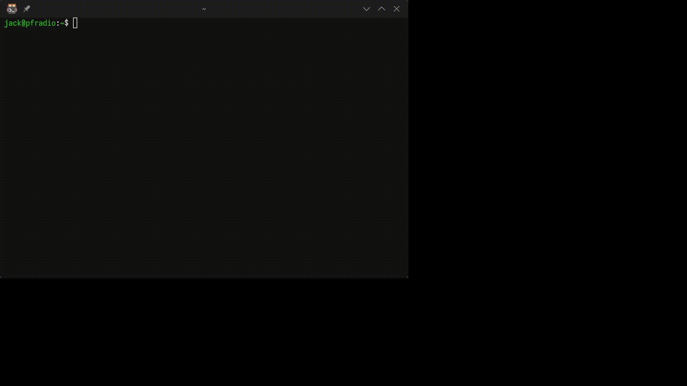

# numconv
### A program designed to convert a number between bases
#### Supports bases 2-36

## Usage
- TUI: `numconv`  

- CMD: `numconv <input number> <input base> <output base>`
	- Example: `numconv 12 10 2`
